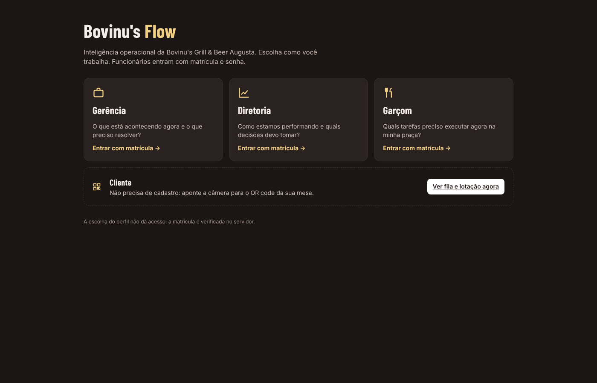
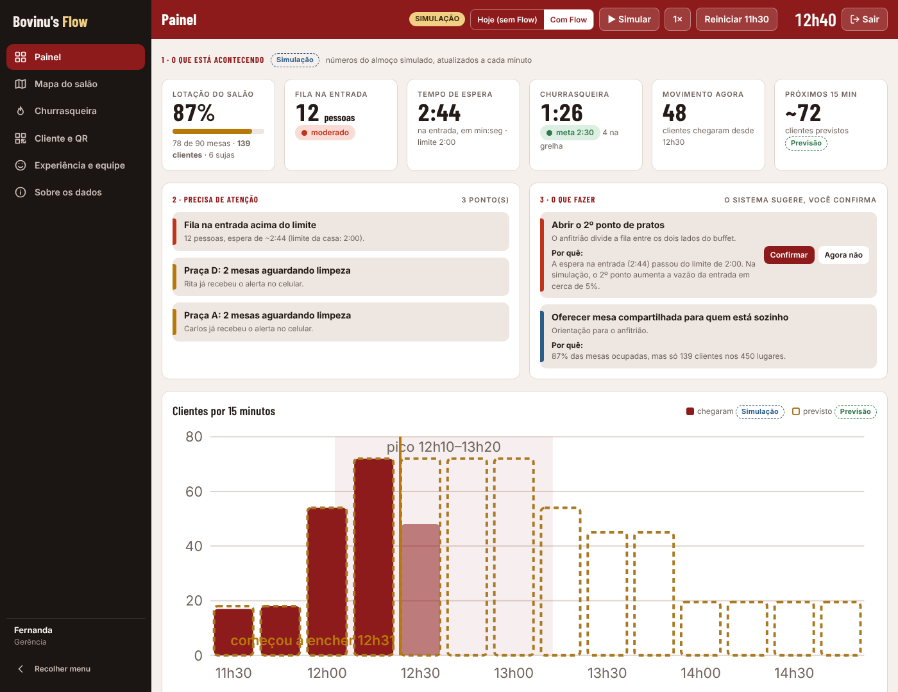
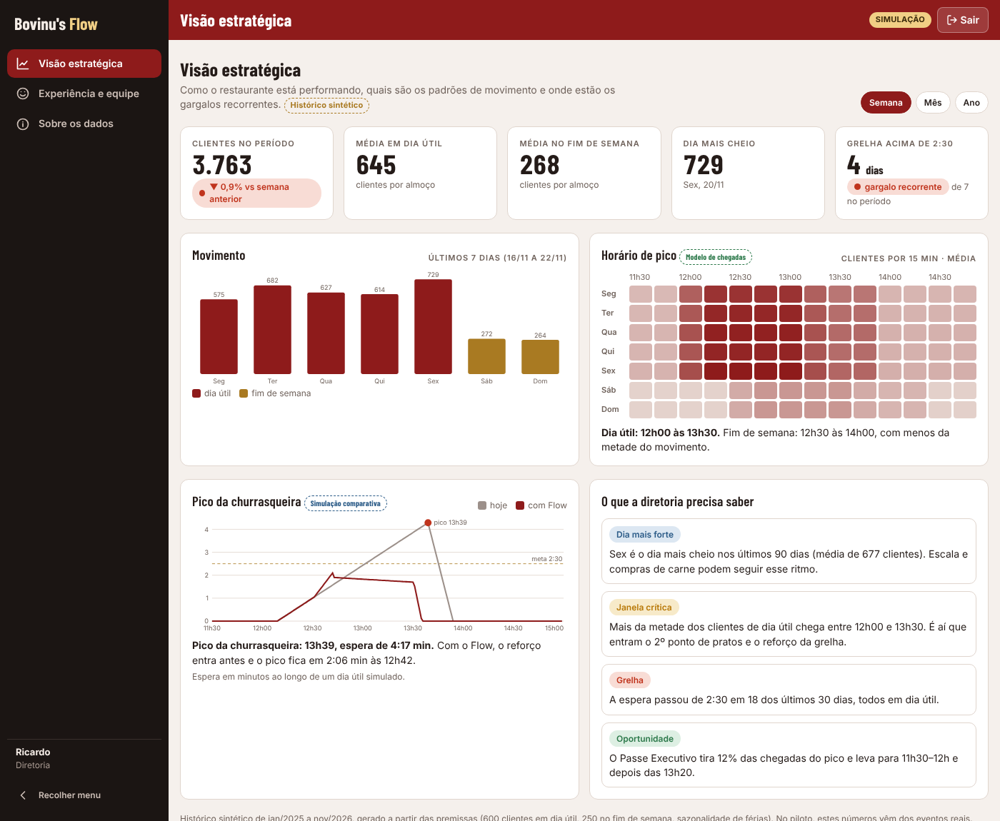
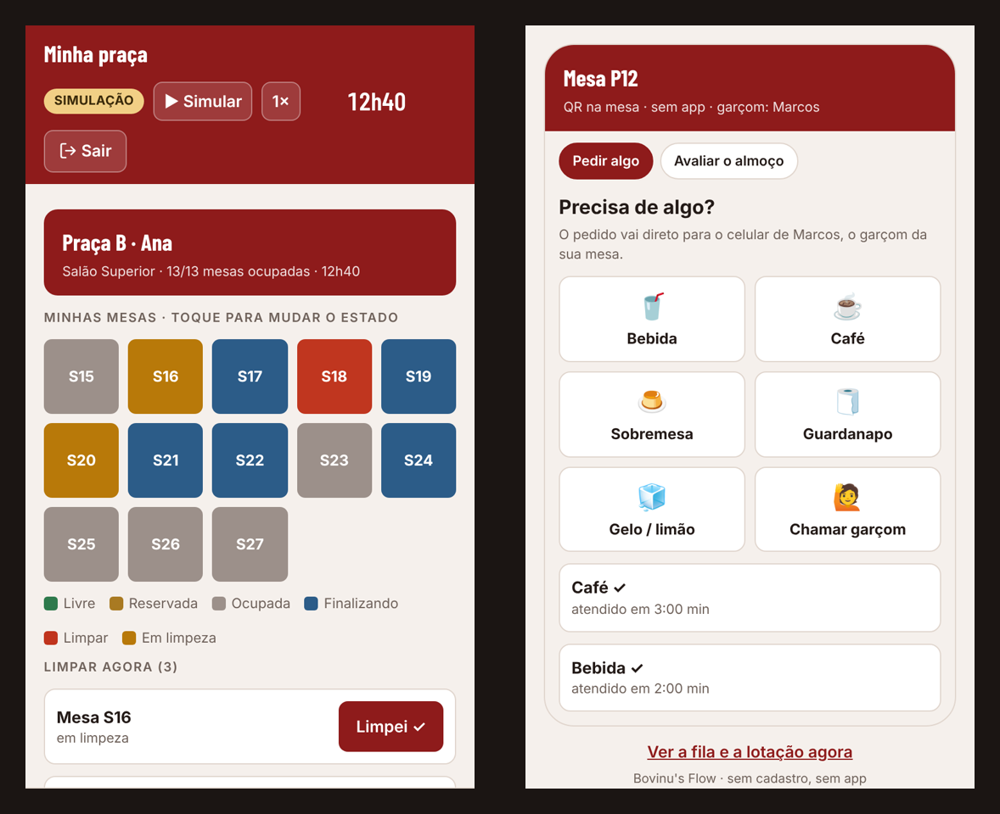
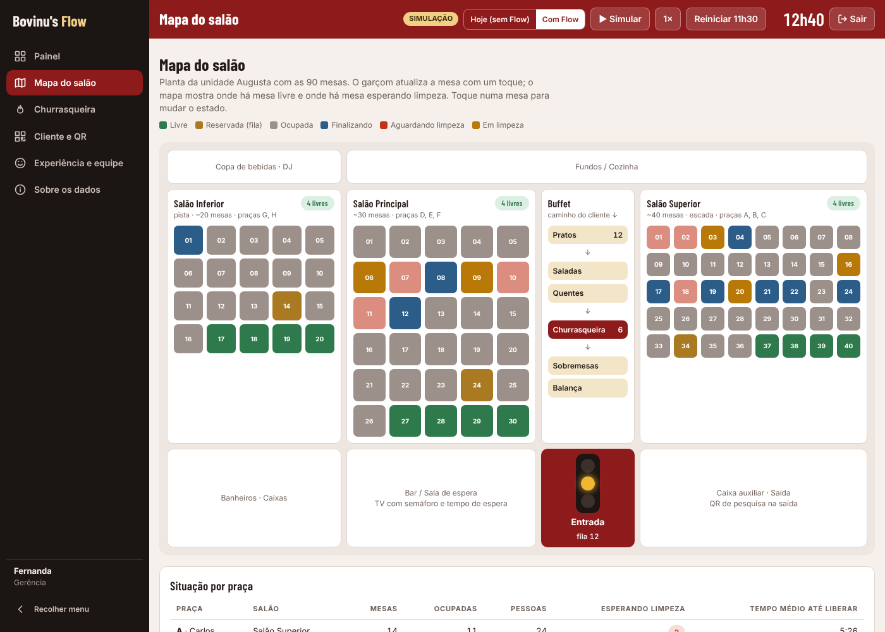
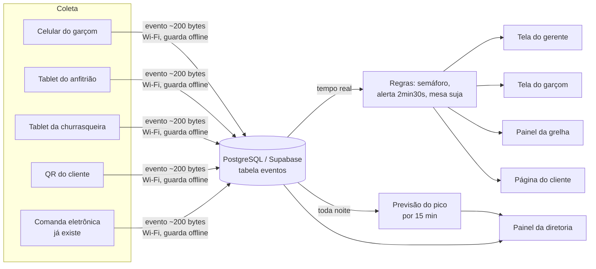
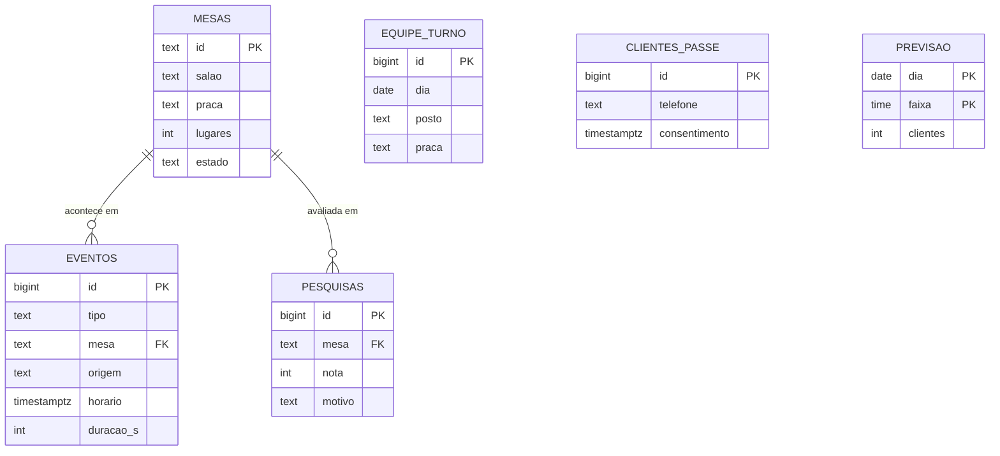

# Bovinu's Flow

Projeto para o **Hackathon Tech FMU 2026.2 × Bovinu's Grill & Beer – Augusta** (almoço por quilo).

> A Bovinu's já sabe quanto pesa o prato. O Flow mostra quanto pesa cada minuto do cliente.

| | |
|---|---|
| **Protótipo funcionando** | https://razzano380.github.io/Hacktoon-Bovinus/ (modo demonstração, sem servidor) · login real com `node server.js` |
| **Slides (5)** | [`slides-bovinus-flow.pdf`](slides-bovinus-flow.pdf) |
| **Vídeo (1min53s)** | https://razzano380.github.io/Hacktoon-Bovinus/video/bovinus-flow-demo.mp4 (arquivo: [`video/bovinus-flow-demo.mp4`](video/bovinus-flow-demo.mp4)) |
| **Equipe** | Juan Razzano · Gustavo Lima · Rodrigo Viana |

> ⚠️ **Todos os números deste projeto são sintéticos.** Vêm de uma simulação e de um histórico gerados a partir de premissas declaradas, não de dados reais da empresa. Não conversamos com os donos nem fizemos pesquisa de campo.

---

## 1. O problema

**Números da unidade (dados da empresa):**

| | |
|---|---|
| Clientes por dia durante a semana | ~618 |
| Consumo médio | 482 g por cliente |
| Preço | R$ 119,90/kg (ou R$ 113,00 no buffet livre, por pessoa) |
| **Ticket médio estimado** | **≈ R$ 57,80** por cliente (0,482 kg × R$ 119,90) |
| **Faturamento estimado do almoço** | **≈ R$ 35,7 mil por dia útil** (618 × R$ 57,80) |

Cada cliente que desiste da fila ou não volta por causa da espera custa cerca de R$ 58 por almoço.

A unidade Augusta recebe cerca de **618 clientes** por dia na semana, com **90 mesas em 3 salões**. Mais da metade das chegadas se concentra num pico curto (premissa nossa: 12h10–13h20). Nesse intervalo, três filas se formam ao mesmo tempo:

- **na balança**, na entrada;
- **na churrasqueira**, esperando a carne;
- **por uma mesa**, enquanto mesas sujas demoram a ser liberadas.

Ninguém vê as três juntas. O gerente descobre o gargalo pela cara do cliente ou, pior, pela avaliação no Google no dia seguinte. A diretoria não tem uma visão simples do movimento da semana, do mês e do ano.

## 2. A solução

O **Bovinu's Flow** transforma cada toque de um funcionário (e cada registro que a comanda já faz) em um **evento com horário**. Somando os eventos, o sistema sabe em tempo real onde está o gargalo e sugere a ação. É **uma plataforma com uma experiência para cada perfil**. Na tela inicial a pessoa escolhe o perfil e entra com matrícula e senha; o servidor confere as permissões e cada um vê só o que precisa:

| Perfil | Aparelho | Pergunta que a tela responde | O que tem |
|---|---|---|---|
| **Gerência** | tablet ou computador | O que está acontecendo e o que preciso resolver? | Painel em 3 níveis (agora, atenção, o que fazer), mapa do salão, churrasqueira, QR das mesas |
| **Diretoria** | navegador | Como estamos performando e o que decidir? | Movimento por semana/mês/ano com comparação, horários de pico, gargalos recorrentes |
| **Garçom** | celular da casa | O que preciso fazer agora na minha praça? | Só as mesas da praça dele, mesas para limpar, chamados, grupos da fila |
| **Cliente** | QR code da mesa, sem app e sem login | Como faço meu pedido? | Mesa identificada pelo QR, pedidos rápidos, avaliação, fila e lotação |

Toda recomendação ao gerente mostra **o motivo** e só muda a operação depois que ele confirma. Cada número leva um selo de origem (*simulação*, *histórico sintético* ou *previsão*), para nenhum dado simulado parecer real.

**Integração entre as frentes:** todas leem e gravam no mesmo fluxo de eventos. O "Limpei" do garçom muda na hora a tela do gerente, a fila do cliente e o histórico da diretoria.

**Fora do escopo:** cozinha, compras, estoque, pagamento e a comanda (o Flow só lê o horário dela).

## 3. Capturas de tela

| | |
|---|---|
|  |  |
| **Tela inicial: cada perfil entra com matrícula** | **Gerente: agora, atenção e o que fazer** |
|  |  |
| **Diretoria: visão estratégica** | **Garçom (praça B) e cliente pelo QR da mesa** |
|  | |
| **Mapa do salão** | |

## 4. Estrutura e integração



**Versão principal:** Supabase (PostgreSQL em tempo real), telas em Next.js como PWA, previsão em Python, WhatsApp Business para o relatório semanal.
**Versão baixo custo:** AppSheet ou Glide com Google Sheets, Forms e Looker Studio. Dá para começar sem equipe de TI.

### Modelo de dados

Esquema completo em [`docs/modelo-de-dados.sql`](docs/modelo-de-dados.sql).



Exemplo de evento (o garçom tocou "Limpei" na mesa S14):

```json
{ "unidade": "augusta", "tipo": "mesa_liberada", "mesa": "S14", "praca": "B",
  "origem": "celular_garcom", "horario": "2026-11-26T12:47:31-03:00", "duracao_s": 212 }
```

**LGPD:** sem câmera no MVP, pesquisa anônima, telefone só com aceite e guarda de no máximo 12 meses.

## 5. Como desenvolvemos

1. **Entender:** lemos o case da Bovinu's (almoço por quilo, 600 clientes, pico curto) e o mapa da unidade.
2. **Escolher:** comparamos 8 ideias de MVP por impacto no cliente, custo e facilidade de testar ([`mvps-bovinus.png`](mvps-bovinus.png)). O Flow venceu por atacar a espera, que é o que o cliente sente.
3. **Modelar:** sem dados da loja, escrevemos uma simulação do almoço (chegadas, balança, grelha, mesas, limpeza) com premissas declaradas e semente fixa, para o resultado ser reproduzível.
4. **Construir:** fizemos o protótipo web em um único arquivo (`index.html`, HTML + CSS + JavaScript puro), publicado no GitHub Pages.
5. **Testar:** rodamos o mesmo dia duas vezes, com as mesmas chegadas, sem e com o Flow, e ajustamos o layout para celular e tablet.
6. **Evoluir para MVP:** trocamos as abas soltas por uma experiência por perfil (tela inicial, login, menu lateral), separamos operação e estratégia, adicionamos um servidor com login e permissões e o QR assinado por mesa, e cobrimos os fluxos com testes automáticos (11 da API e 20 no navegador). Detalhes em [`docs/mvp-perfis.md`](docs/mvp-perfis.md).

## 6. Resultado esperado (simulação)

| Indicador (dia útil, 600 clientes) | Hoje | Com Flow | Meta do piloto |
|---|---:|---:|---:|
| Maior fila na entrada | 6,5 min | 4,1 min | –20% |
| Grelha atendida em até 2min30s | 69% | 100% | 85% |
| Tempo para liberar a mesa | 7,9 min | 5,2 min | –30% |
| Tempo para achar mesa | 2,2 min | 0,7 min | a medir |
| Clientes satisfeitos (estimado) | ~55% | ~85% | a medir |

Simulação com dados sintéticos; não é medição real. Na simulação o reforço da grelha é acionado sempre que a espera passa de 2 min, por isso chega a 100%.

**Próximo passo:** piloto de 4 semanas na Augusta, uma peça por semana (QR nas mesas → celular do garçom → fila e grelha → painel do gerente). Investimento estimado: ≈ R$ 2.700 de equipamento (2 tablets e QR nas 90 mesas) + até R$ 350/mês. Os valores são estimativas de mercado, sem cotação.

**Retorno:** com ticket médio de ≈ R$ 57,80, **47 almoços** pagam o equipamento e **6 almoços por mês** pagam a mensalidade. Em uma casa com ~618 clientes por dia, evitar 1 desistência a cada 2 dias úteis já paga o primeiro ano (47 + 12 × 6 = 119 almoços em ~264 dias úteis).

A simulação usa 600 clientes por dia útil (premissa anterior ao dado de 618); a diferença não muda as conclusões.

## 7. Como rodar

### Com login e permissões (recomendado)

Precisa só do Node 18 ou mais novo. Não há dependências para instalar.

```bash
node server.js            # abre em http://localhost:8080
npm test                  # testes da API (login, permissões, QR)
```

| Perfil | Matrícula | O que vê |
|---|---|---|
| Gerência | `1001` | Painel em 3 níveis, mapa do salão, churrasqueira, QR das mesas, experiência e equipe |
| Diretoria | `2001` | Visão estratégica, experiência e equipe |
| Garçom | `3001` a `3008` (praças A a H; `3002` = Ana, praça B) | Só a própria praça, no celular |
| Cliente | sem login | Abre pelo QR da mesa (`#mesa/<token>`) ou pela página pública `#agora` |

Senha de demonstração: `bovinus2026`. **Troque as senhas e defina `SESSION_SECRET` e `QR_SECRET` antes de qualquer uso real** (ver [`docs/mvp-perfis.md`](docs/mvp-perfis.md)).

### Sem servidor (GitHub Pages ou abrindo o `index.html`)

O site detecta que não há servidor e entra em **modo demonstração**: dá para navegar por todos os perfis, mas nada é protegido, e a tela avisa isso.

No protótipo, cada pessoa que abre o site roda a própria simulação; as telas não são compartilhadas entre aparelhos.

Detalhes do MVP por perfis (diagnóstico, decisões, arquitetura e pendências): [`docs/mvp-perfis.md`](docs/mvp-perfis.md).

## 8. O que tem no repositório

| Arquivo / pasta | O que é |
|---|---|
| `index.html` | Interface completa (HTML + CSS + JavaScript puro) |
| `server.js` | Servidor do MVP: login, sessão, permissões e QR assinado (Node, sem dependências) |
| `server/usuarios.json` | Funcionários de demonstração (senhas só como hash scrypt) |
| `tests/` | Testes da API (`npm test`) e de ponta a ponta no navegador (`tests/e2e.mjs`) |
| `slides-bovinus-flow.pdf` | Apresentação em 5 slides |
| `video/bovinus-flow-demo.mp4` | Vídeo de 1min53s com o MVP funcionando: perfis, gerente, garçom, cliente pelo QR e diretoria (com legendas, sem narração) |
| `deck/` | Fonte dos slides |
| `capturas/` | 5 capturas de tela da solução |
| `docs/modelo-de-dados.sql` | Esquema do banco proposto |
| `docs/qr-prototipo.png` | QR code que abre o protótipo |
| `mvps-bovinus.html` / `.png` | Quadro com as 8 ideias de MVP avaliadas |

## Avisos

- **Dados sintéticos:** simulação e histórico gerados a partir de premissas declaradas; não são dados reais da empresa.
- A escala de equipe sugerida no protótipo é estimativa e deve ser validada com RH, Jurídico e sindicato. Não é parecer jurídico.
